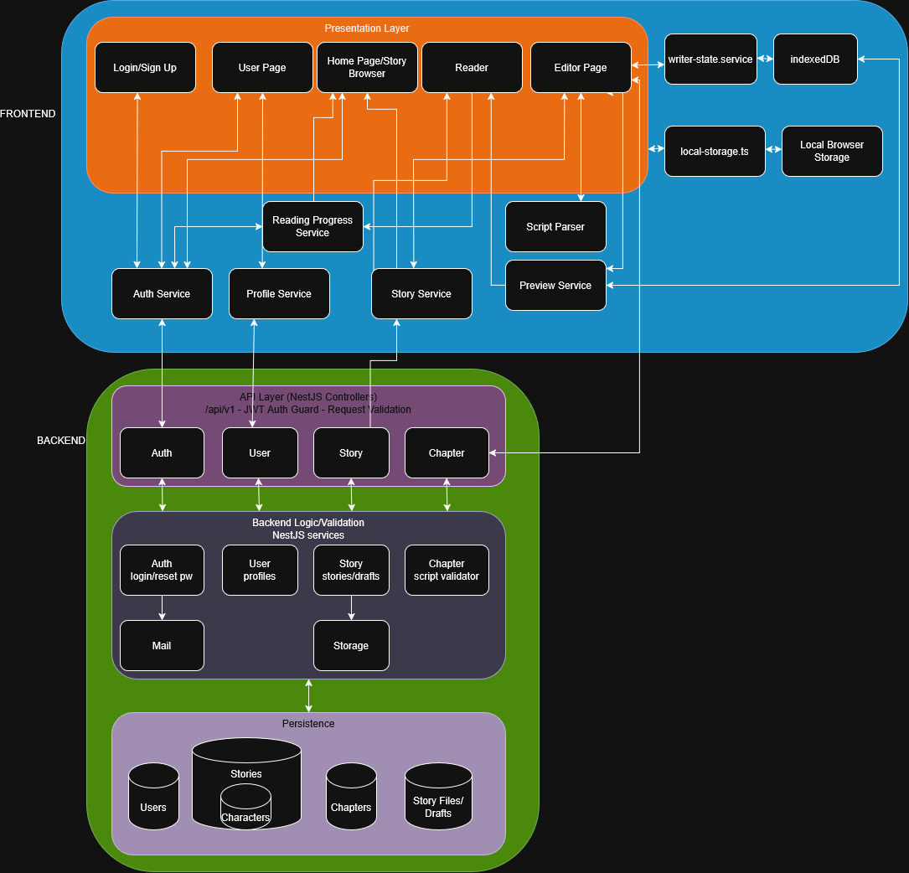

# Sprint 2

## Sprint Summary

In Sprint 1, we completed the parser, the reader feature, and the setup of the backend database, however, the reader was only using a mock chapter for every story, and the writing functionality and deployment was pushed to Sprint 2. For Sprint 2, we worked on finishing up these tasks while also extending the functionality of The Story Machine.

In Sprint 2:

- **Story Organization**: Each story now properly retrieves its own chapter contents, instead of displaying the same chapter for every story
- **Deployment:** We deployed our application at <https://comp4350-frontend.proudmoss-9dbb54ec.westus.azurecontainerapps.io/>.
- **Accounts:** Introduced accounts feature, so users can now register, sign in, have their own profile page, while also being able to view others, as well as remember the reading progress per account.
  - So as not to limit our users, an account is not required to read stories and a Guest account is provided by default
- **Parser adjustments:** The lexer and parser were also made more robust by adding more user facing errors for syntax mistakes, along with the addition of new dialogue syntax
- **Editor page:** Users can now create a story and write it themselves. Users can get a preview of the story, and there is a short tutorial on using the editor that will get refactored.
- **Create characters from the editor:** users can create characters and assign them images called emotions. There is a small editor which allows the user to control of panning and zoom of the images. These images still wont display in the stories themselves, but the functionality and image editing is there for sprint 3.
- **Uploaded Images are changed to webP:** when a user uploads an image, its turned into a webP before saving. This saves 50% of the storage space.
- **Users can now save and publish stories:** The editor now has buttons which allow the users to save a story, meaning the draft is uploaded to the backend. And to Publish a story meaning users can upload a story for others to read.
- **Users can now edit and delete stories:** From the landing page or a public profile, if a user owns a story, they have the option to edit or delete stories. Editing stories allows users to retrieve all their saved information from a draft and continue to work on it.
- **Parser Error Message Management:** Error messages for the parser now live in one place enabling faster iteration on error message to let them be more user facing, with this change we'e also reworked our old parser error messages.

## Regression Testing

### Frontend

**What runs:** the whole frontend suite, 38 test files and 510 tests (`npm run test:ci`). Unit tests cover each service, page and component, and three integration tests cover the main flows: reading a story through the real routes, opening the writer at `/write/:storyId`, and example scripts going through the parser into the reader. The backend is always faked, so runs are fast and repeatable. We run every test instead of choosing a subset because the suite only takes a few seconds, and we add a test for each feature and each bug we fix.

**When and how long:** on every pull request and push to `develop`, `staging` and `main` (Husky only lints and formats on commit). The tests take about 7-9 seconds, and a full CI run takes about 2m 43s. Latest CI run: https://github.com/laradeleon/the-story-machine/actions/runs/44803738914

**When it fails:** a failing test, coverage under 75%, or a lint, build or audit error fails the CI check on the pull request, and the Docker image isn't built. The author fixes it and pushes again. Code only reaches `main` through pull requests, so failing code never gets deployed.

### Backend

[Regression testing for backend](https://github.com/nifemi-cd/the-story-machine-backend/blob/develop/docs/regression-testing.md)

## Testing Status & Gaps

[Test coverage report for Sprint 2 (frontend and backend)](test-coverage-report). Frontend: 94.81% statements, 91.21% branches, 96.64% lines, with all 510 tests passing.

**Frontend gaps:**

- **Reader controls** (`reader.ts`, 79% of lines): keyboard controls, the Next Chapter button and resuming after a deleted chapter aren't tested.
- **Frontend and backend together:** Save Draft, Publish and Edit are only tested against a faked backend, so a mismatch between the two wouldn't be caught.
- **Layout:** tests run in a simulated browser that doesn't draw the page, so layout bugs are found manually through use.

## CI / CD Status

### Continuous Integration

Our CI setup from Sprint 1 is still in place in both repositories: Husky and lint staged are running the linter and Prettier on staged files before every commit we make. A GitHub Actions CI workflow runs on every pull request into `develop`, `staging` and `main` and on every push to those branches.

| Repository | CI workflow                                                                                                         | Run history                                                                         |
| ---------- | ------------------------------------------------------------------------------------------------------------------- | ----------------------------------------------------------------------------------- |
| Frontend   | [`.github/workflows/ci.yml`](https://github.com/laradeleon/the-story-machine/blob/develop/.github/workflows/ci.yml) | [Actions](https://github.com/laradeleon/the-story-machine/actions/workflows/ci.yml) |
| Backend    | [`.github/workflows/ci.yml`](https://github.com/nifemi-cd/the-story-machine/blob/develop/.github/workflows/ci.yml)  | [Actions](https://github.com/nifemi-cd/the-story-machine/actions/workflows/ci.yml)  |

Each run installs dependencies (`npm ci`), lints, checks formatting, type checks (backend), runs the tests, builds the project, runs `npm audit` for high severity vulnerabilities and then builds the production Docker image.

#### New in Sprint 2: coverage threshold

In Sprint 1 we noted that CI did not enforce any minimum coverage. The frontend now runs its tests with coverage in CI (`npm run test:ci` runs `ng test --watch=false --coverage`) and the run fails if coverage drops below a set minimum. The thresholds are set with `coverageThresholds` in `angular.json`:

| Statements | Branches | Functions | Lines |
| ---------- | -------- | --------- | ----- |
| 75%        | 75%      | 75%       | 75%   |

We set the threshold slightly below our current coverage as currently, our main goal is to stop coverage from going down, for example when a feature is merged without tests. If a pull request drops coverage, the CI check fails. We plan to raise the thresholds as coverage improves.

### Continuous Deployment

Both repositories now have a **CD** workflow that deploys to **Azure Container Apps**. This was the main thing we left unfinished in Sprint 1.

| Repository | CD workflow                                                                                                      | Run history                                                                         | Deploys to                        |
| ---------- | ---------------------------------------------------------------------------------------------------------------- | ----------------------------------------------------------------------------------- | --------------------------------- |
| Frontend   | [`.github/workflows/cd.yml`](https://github.com/laradeleon/the-story-machine/blob/main/.github/workflows/cd.yml) | [Actions](https://github.com/laradeleon/the-story-machine/actions/workflows/cd.yml) | `comp4350-frontend` container app |
| Backend    | [`.github/workflows/cd.yml`](https://github.com/nifemi-cd/the-story-machine/blob/main/.github/workflows/cd.yml)  | [Actions](https://github.com/nifemi-cd/the-story-machine/actions/workflows/cd.yml)  | `comp4350-api` container app      |

- **Trigger:** every push (merge) to `main`. Changes reach `main` only through `develop` -> `staging` -> `main` pull requests so that all code has passed CI before it is deployed.
- **Automated steps:** log in to Azure, build the Docker image, push it to our Azure Container Registry and update the container app to that image.
- **Environment:** production on Azure Container Apps. The frontend image is nginx serving the built Angular app. nginx also forwards `/api/` requests to the backend container app so the frontend can just use relative `/api` URLs.
- **Secrets:** GitHub Actions logs in to Azure with **OIDC**, so no Azure password is stored anywhere. The only GitHub secrets are `AZURE_CLIENT_ID`, `AZURE_TENANT_ID` and `AZURE_SUBSCRIPTION_ID`. Backend settings such as `MONGO_URI` and the Azure Storage connection string are stored as Container Apps secrets.
- **Success or failure:** each deploy shows up as a run in the CD Actions tab. If the build, the push or the container app update fails, the run fails and GitHub notifies whoever triggered it. After a successful run, we check the live URL.

## Live Deployment

<https://comp4350-frontend.proudmoss-9dbb54ec.westus.azurecontainerapps.io/>

## Cross-Team Testing

We posted our cross-team review of Palette as a comment on ArionKennedy/PaletteProject#100. It covers the workflows we tried (sign-up, sign-in, and searching movies, books and TV), what worked well, and the issues we ran into, like the breached-password message and the “API request failed: 401” error. we also left a few suggestions for the team to consider before the final release.

You can find our critique here. https://github.com/ArionKennedy/PaletteProject/issues/100

#### Response

##### Issue 1: Unclear Story Creation Process

Recommendation: _Consider introducing a more detailed, step-by-step tutorial within the application to guide users through the story creation process._
Status: Accepted.

User friendliness and author onboarding would be a primary goal for us. So the suggestion to overhaul it to guide the user through the story creation process shows that we've failed on something that should be fundamental to our project. So, for sprint 3, we plan to overhaul our tutorial on a seperate page with a step by step guide. Will put a big button on the landing page so that it'll be one of the first elements users will see when they open up the page. Right now, the only tutorial element that exists generates in the code mirror on creating a new story. In hindsight, that is not enough to onboard users.

##### Issue 5: Example button UI inconsistency

Recommendation: Try to incorporate another page into the application to show the example or have it as a sorta popup menu as well as it follow the same button design language.
Status: Deffered

The different buttons occured from working on different parts of the system at different times, ideally will come back to work on the visual desgin of the website, but at the moment, functionality and usability remain our highest priority. If we have time in sprint 3, we would like to overhaul the design of the editor page to better match what exists in other areas of the app.

Feedback were responding to: https://github.com/laradeleon/the-story-machine/issues/95

## API & Architecture

### API Documentation

The backend API is still documented with **Swagger**, the same as in Sprint 1. It lists every route, request body, field rule and possible response, with examples, and requests can be sent straight from the page. The difference this sprint is that the API is deployed, so the docs can be opened without building the backend:

**<https://comp4350-api.proudmoss-9dbb54ec.westus.azurecontainerapps.io/api/docs>**

#### What changed since Sprint 1

- **New Auth routes:** `POST /api/v1/auth/login` returns an access token, and `GET /api/v1/auth/me` returns the signed-in user.
- **Login is required to change anything.** Creating, editing or deleting a story or chapter, uploading a story file, saving a chapter script and updating your own profile now need an `Authorization: Bearer <accessToken>` header. Without it, these routes return `401`.
- **Authors come from the token.** In Sprint 1, creating a story took the author's id (`authorId`) in the request body. Now the backend uses the signed-in user as the author, and only the author can change or delete a story (anyone else gets `403`).
- **Public profiles:** `GET /api/v1/user/{id}/profile` returns only a user's public details (display name, username, bio), so profile pages can be shown to anyone without exposing private fields like email.
- **Admin-only routes:** listing all users, getting a user by id and editing another user's profile now need an admin account.
- **Reading stays public:** listing stories, getting a story and its chapters, and downloading a story file don't need an account, so Guests can read everything.

#### Using the Swagger page

- Routes are grouped into **Auth**, **Users**, **Stories** and **Chapters**. Click a route, then **Try it out**, fill in the parameters or body, and **Execute**.
- To try a protected route, register (`POST /api/v1/user`) if you don't have an account, log in (`POST /api/v1/auth/login`), copy the `accessToken` from the response, click **Authorize** at the top of the page, and paste it in. Swagger then sends the token with every request.
- Every response is still wrapped the same way. A success looks like `{ "success": true, "message": "Story created", "data": { ... } }`, and an error looks like `{ "success": false, "message": "...", "errors": [ ... ] }`.

**Creating a readable chapter** now takes four requests, in order: log in and authorize, create the story with its characters (`POST /api/v1/story`), add a chapter with its parsed script (`POST /api/v1/story/{storyId}/chapter`), then fetch the chapter (`GET /api/v1/story/{storyId}/chapter/{id}`), which returns it in the story JSON format the reader plays.

#### Running it locally

The steps are the same as in [Sprint 1](../sprint-1/sprint1.md#4-api-documentation). Run `npm ci`, copy `.env.example` to `.env`, run `npm run start:dev` and open `http://localhost:<PORT>/api/docs`. The only difference is that `.env` now needs two more variables for login:

| Variable         | What it is                                                          |
| ---------------- | ------------------------------------------------------------------- |
| `JWT_SECRET`     | A long random string used to sign login tokens.                     |
| `JWT_EXPIRES_IN` | How long a login token lasts, in seconds (e.g. `3600` for one hour) |

To run the frontend against it, start the backend on port `4563`, then run `npm ci` and `npm start` in the frontend repository. The dev server still forwards `/api` to `http://localhost:4563` (`proxy.conf.json`). In production, nginx forwards `/api` to the deployed backend instead (see [CI / CD Status](#ci--cd-status)).

## Architecture

## Reflection & Risk

### Individual Reflection Contribution

**Lara De Leon**
_What technical decision or implementation improved most since Sprint 1, and why?_

For me, the biggest improvement since Sprint 1 is that the backend now has authentication. In Sprint 1, the API had no idea who was sending a request, and this was fine while we were only testing with our own data. The main reason I think this improved the most is that the server now decides who is allowed to do what, instead of believing whatever the request says. It's also the base that everything else this sprint needed. Saving reading progress per account, showing your own stories on your profile and tying a story to its writer all depend on the app knowing who you are, and auth was what made all this possible.

**Krupal Patel**
_What feedback from Sprint 1 did the team act on, and what changed as a result?_

Our Sprint 1 feedback was mostly positive and didn’t point out much to fix, so most of our changes came from our own look back at the sprint. We saw that the frontend and backend were often working separately and only connecting at the end, which slowed us down. In Sprint 2 we met more often and talked more between those meetings, so problems got raised early instead of during merges. This also helped us build better backend features. Agreeing on things like validation rules and error formats up front made the frontend much easier to connect. For example, the user accounts feature worked more smoothly because both sides knew what to expect. Overall, better communication made our work more consistent, and our PRs and reviews went faster this sprint.

**Arthur McMullen**
_What is the most important technical risk or uncertainty going into the final iteration?_

Right now, draft and published content share the same information on the backend, in hindsight, I'm not sure how no one managed to spot a pretty major technical risk in our design. Them sharing the same information means this, when I publish my story, it uploads all the metadata, characters and eventually images that will be used in the live story. The issue is that drafts use the same information as a published story. So, lets say I'm a user, I publish my story, then decide I want to rework some aspects of it, like maybe the characters, their portraits and even the title. Then if I try to save the draft, the live published version will get updated as well. That means if the characters are all wrong, It will desync the live version from the database and bypass our validation. Going into sprint 3, this is the primary concern we have to address.

**Colin Leger**
_What technical decision or implementation improved most since Sprint 1, and why?_

For me, since I solely worked on the scripting language, I believe our most improved implementation would be the error handling and user facing error messages as well as the improved robustness of the language. In sprint 1, we had error messages built directly into the lexer and parser, all messages were scattered around the place and error types were all generic so things were pretty unorganized. Now, in sprint 2, errors are all in the same place, in a standardized format and custom typed appropriately. This makes our code much easier to read and enforces separation of concerns where errors are defined in one place and used in another. This also allowed for new errors to be implemented easily and follow the previously made errors standardized format. In terms of robustness, the scripting language now is much more forgiving when writing dialogue and supports new syntax for really long dialogue where you need to write it across multiple lines. It also fails gracefully, always providing some user facing information on how to fix what went wront if they run into issues.

**Carsten Kolynchuk**
_What feedback from Sprint 1 did the team act on, and what changed as a result?_

During sprint 1 one thing we agreed on was that our communication was adequate, but could have been better. As a result, during sprint 2 we were much more active about sharing our progress, both in terms of how often we shared progress and how detailed said progress reports were. This allowed for better work regarding functions that used the parts our team members were actively working on.

### Work the Team Is Proud Of

**[Accounts](https://github.com/laradeleon/the-story-machine/issues/43)** ([PR #80](https://github.com/laradeleon/the-story-machine/pull/80), [PR #90](https://github.com/laradeleon/the-story-machine/pull/90))

The work we're most proud of this sprint is accounts, built from the [Account Creation (#27)](https://github.com/laradeleon/the-story-machine/issues/27), [Sign In/Sign Out (#28)](https://github.com/laradeleon/the-story-machine/issues/28), [Remember Reading Progress (#32)](https://github.com/laradeleon/the-story-machine/issues/32) and [User Profile Page (#30)](https://github.com/laradeleon/the-story-machine/issues/30) user stories. We picked it because:

1. **It makes the app worth coming back to.** Initially having no accounts was a bigger problem for us than for most reading apps because our stories branch. So a reader who leaves halfway and has to start over also loses every choice they made to get there, and they may not find the same path again. Saving progress per account is what lets someone read a story over several sittings, which is how most people will actually read anything longer than a few minutes. We were also careful that this doesn't push people away. You don't need an account to read and Guests still get their progress saved.

2. **It was the first feature our whole group built together.** Until now, the parser, the reader and the backend could mostly be worked on separately. But accounts touched everything, like login and route protection on the backend, the sign in and register popup, the account menu, the reader saving progress, the Continue Reading list on the home page, and the profile page. It also showed us where we needed to coordinate better. When the backend started requiring sign-in, stories briefly stopped loading on the home page until we fixed it in [PR #77](https://github.com/laradeleon/the-story-machine/pull/77), and we had to line up the frontend's password and error messages with the backend's rules. Working through those problems is a big part of why we're proud of how it turned out.

This is also what moves the app toward what we set out to build. In Sprint 1, The Story Machine was a reader and a parser. You could read a story but you didn't know who wrote it, and the app didn't know who you were. Now a reader can find a story, see who wrote it, open their profile and find more of their work.

### Risks

**Reading progress is only in the browser.**
Progress is saved per account but in the browser's local storage (`reading-progress.service.ts`), not on the backend. So if a reader starts a story on their laptop and opens the app on their phone, their progress isn't there, and clearing browser data wipes it. We chose this to get progress working for both Guests and signed-in users this sprint without needing new backend routes. For signed-in users, the fix is to move progress to the backend so it follows the account, and keep local storage for Guests.

**Save Draft on a published story changes contents for live story**
Mentioned in Arthur's reflection. The save draft will update the meta data and character information which will change the server on live, that also means it can break stories as the character information will no longer be in sync. Will have to refactor next sprint so that we keep copies of meta data for drafts or find a different solution

**Unpublished Drafts dont exist for users**
The front end has no way of seeing unpublished drafts meaning we get a bunch of abandoned stories that pile up in our backend, that should be a feature for next sprint. For a user, that means unless they click publish, they can no longer see the draft ever, even if its published. [PR #103](https://github.com/users/laradeleon/projects/1/views/1?pane=issue&itemId=312074626&issue=laradeleon%7Cthe-story-machine%7C103)

**Written tutorial on story creation doesnt preview**
Because characters are now needed to validate a story, the previewer is unable to actually parse the tutorial script. For sprint 3, will make it so characters are no longer validated in the script, and instead no character defaults to an empty portrait. Will also overhaul the tutorial to make it more clear how individual elements work.
